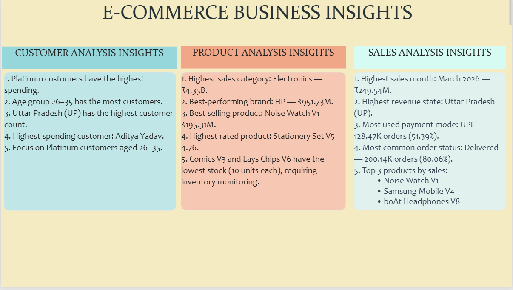

🛒 E-Commerce Customer, Product & Sales Analytics

An interactive Power BI dashboard project built to analyze e-commerce customer behavior, product performance, and sales trends using customer, product, and sales data.

The project transforms raw data into four dashboard pages: Customer Analysis, Product Analysis, Sales Analysis, and Summary.

📊 Dashboard Preview

The screenshots below are stored in the repository root. These image links use the exact filenames shown in your GitHub file list.

1. Customer Analysis Dashboard

Analyzes customer demographics, spending behavior, customer tiers, registration trends, and customer locations.

2. Product Analysis Dashboard

Analyzes product categories, brands, ratings, pricing, discounts, inventory, and product sales performance.

3. Sales Analysis Dashboard

Tracks revenue, discounts, shipping costs, order values, quantities, payment methods, order statuses, and sales trends.

4. Summary Dashboard

Combines key observations from the customer, product, and sales dashboards.
## 📊 Dashboard Preview

### Customer Analysis Dashboard

---

### Product Analysis Dashboard

---

### Sales Analysis Dashboard

---

### Summary Dashboard

🎯 Project Objectives

Analyze customer demographics and purchasing behavior.

Identify high-value customer segments.

Evaluate product, category, and brand performance.

Review inventory levels, ratings, prices, and discounts.

Track sales and revenue trends over time and across locations.

Analyze payment methods and order statuses.

Identify top-performing customers and products.

Present business-oriented findings through interactive Power BI dashboards.

📁 Dataset

The project uses three CSV datasets:

customers.csv — customer demographics, location, customer tier, registration, orders, and spending.

products.csv — product category, brand, rating, price, discount, stock, and product details.

sales.csv — transactions, sales amount, quantity, payment method, order status, and related sales information.

Note: Ensure all three CSV files are included in the repository if you want others to refresh and explore the report.

📈 Dashboard Pages

1. Customer Analysis Dashboard

Key metrics

Total Customers: 39.115K

Total Orders: 244K

Total Spending: ₹4,63,93,27,069.20

Average Customer Spending: ₹118.61K

Visualizations

Customers by age group

Total spending by customer tier

Customer registration trend

Customers by city, state, gender, and tier

Top customers by spending

Key observations

Platinum customers have the highest spending.

The 26–35 age group has the highest customer count.

Uttar Pradesh (UP) has the highest customer count.

Aditya Yadav is displayed as the highest-spending customer.

2. Product Analysis Dashboard

Key metrics

Total Products: 2K

Total Stocks: 2K

Total Categories: 7

Total Brands: 33

Average Rating: 4.40

Average Selling Price: ₹2.00K

Visualizations

Stock by category

Sales by brand and category

Discount analysis

Quantity sold by product

Original price vs. selling price

Top 10 products by sales

Product rating analysis

Best-selling and highest-rated products

Products needing attention

Key observations

Electronics is the highest-sales category, with approximately ₹4.35B in sales.

HP is displayed as the highest-performing brand by sales.

Noise Watch V1 is displayed as the best-selling product.

Stationery Set V5 is among the highest-rated products.

Comics V3 and Lays Chips V6 have low stock levels and may need inventory monitoring.

3. Sales Analysis Dashboard

Key metrics

Total Sales: ₹5.99B

Total Discount: ₹62.50M

Shipping Cost: ₹1.23M

Average Order Value: ₹23.97K

Total Quantity Sold: 312K

Total Orders: 250K

Visualizations

Sales by state and customer tier

Sales by year and month

Sales by category and brand

Top 10 customers and products by sales

Payment mode analysis

Order status analysis

Sales trend

Key observations

March 2026 is displayed as the highest-sales month.

Uttar Pradesh has the highest displayed revenue by state.

UPI is the most-used payment method.

Delivered orders form the largest order-status segment.

Noise Watch V1, Samsung Mobile V4, and boAt Headphones V8 are among the top products by sales.

4. Summary Dashboard

The Summary page brings together the main observations:

Customers: Platinum customers lead spending; ages 26–35 form the largest customer group; Uttar Pradesh leads customer count.

Products: Electronics leads sales; HP leads brand sales; Noise Watch V1 is shown as the top-selling product; some products have low stock.

Sales: March 2026 leads monthly sales; Uttar Pradesh leads displayed state revenue; UPI is the most-used payment method; delivered orders are the largest status segment.

These are observations reported by the dashboards and may change when report filters or slicers are applied.

🛠️ Tools & Technologies

Power BI Desktop — dashboard development and visualization

CSV — source data

Power Query — data cleaning and transformation

DAX — measures and analytical calculations

Power BI visuals and slicers — interactive reporting

🔄 Analytical Workflow

CSV Source Data
      ↓
Import into Power BI
      ↓
Data Inspection & Preparation (Power Query)
      ↓
Data Model & Relationships
      ↓
DAX Measures / Calculations
      ↓
Charts, Cards & Interactive Filters
      ↓
Customer, Product, Sales & Summary Dashboards
      ↓
Business Observations

💡 Business Questions Addressed

Which customer segments spend the most?

Which age group and locations have the most customers?

How do customer registrations change over time?

Which product categories and brands generate the most sales?

Which products sell the most and receive the highest ratings?

Which products have low stock and may need replenishment?

How do sales change month by month?

Which states contribute the most revenue?

Which payment methods are most commonly used?

What is the distribution of order statuses?

📂 Project Structure

Based on the files shown in your GitHub repository:

E-Commerce-Customer-Product-Sales-Analytics/
│
├── Customer Analysis Dashboard.png
├── Product Analysis Dashboard.png
├── Sales Analysis Dashboard.png
├── Summary.png
├── customers - customers.csv
├── products - products.csv
└── README.md

If you add the sales CSV and Power BI report, include them in this structure as well. Your current screenshot shows the dashboard images and customer/product CSV files; it does not show sales.csv or the .pbix report.

🚀 How to View

Open the dashboard screenshots in this repository to view the report pages.

To interact with the report, add the Power BI .pbix file to the repository or share it separately.

To refresh the report, include the required CSV source files and update their paths in Power BI as needed.

🧠 Skills Demonstrated

Data preparation with Power Query

Data modeling in Power BI

DAX calculations and measures

Customer behavior analysis

Product and inventory analysis

Sales and revenue analysis

Interactive dashboard design

Data visualization

Communicating business observations

📝 Conclusion

This project combines customer, product, and sales data in Power BI to explore e-commerce behavior, product performance, and sales trends. Its four dashboard pages present an interactive, business-oriented view of the data and help identify patterns relevant to customer, sales, and inventory decisions.
